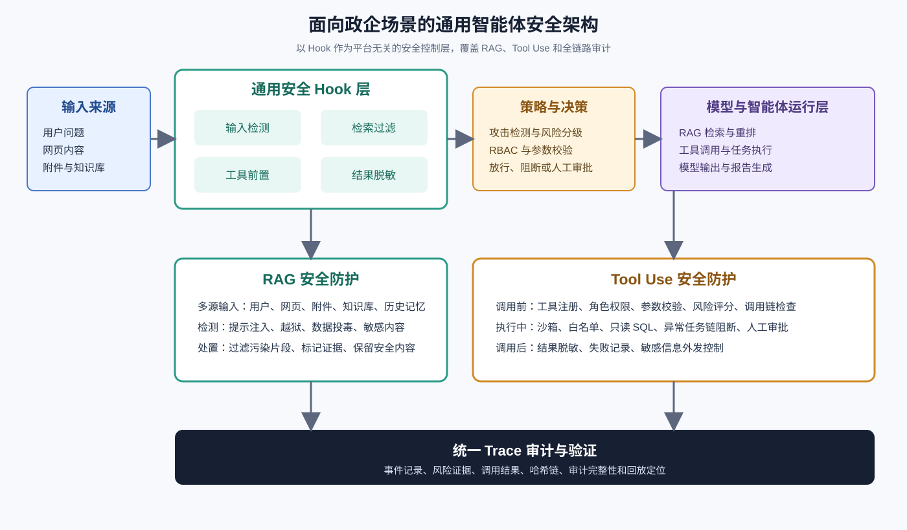
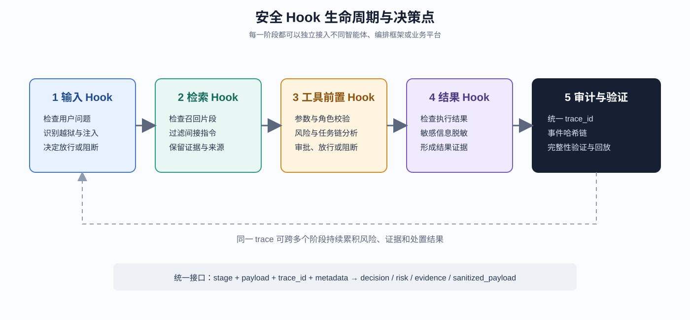
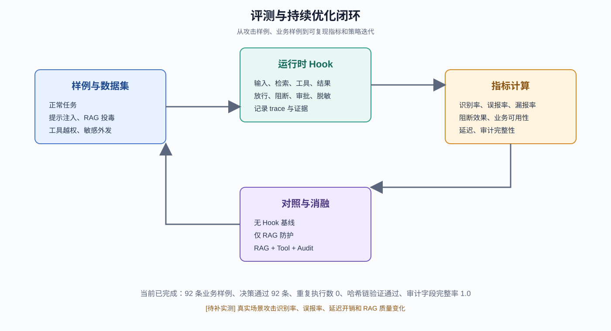

# 面向政企场景的通用智能体安全 Hook 与 RAG Tool Use 联合防护系统

## 技术方案报告初稿

**题目编号：** XA-202620  
**适用赛题：** 面向政企场景的大模型智能体安全关键技术研究  
**报告状态：** 初稿，运行环境、真实业务数据和最终截图待补充  
**版本日期：** 2026 年 9 月 11 日

> 本报告依据赛题方案、当前原型系统、六位组员的代码与文档、已分析的开源安全项目，以及 Agent/RAG 安全领域公开论文整理形成。报告中的“已实现”表示已经在当前代码仓库完成并通过本地测试；“待补”表示需要在完整依赖、真实模型、数据库、向量库或演示环境启动后补充实测结果。

## 摘要

随着大模型从问答工具演进为能够检索知识、调用工具、处理文件、访问外部系统和自动执行任务的智能体，政企应用的安全边界已经从单一模型输出扩展为一条包含输入、记忆、检索、推理、工具调用、结果处理和审计的复杂链路。传统的关键词过滤或单点内容审核难以覆盖间接提示注入、知识库投毒、工具越权、敏感信息外发、插件与 Skill 供应链风险以及责任追踪等问题。

本项目面向政务服务、企业知识检索、业务流程辅助和行业研究等政企场景，提出一种平台无关的通用安全 Hook 架构。系统以 Hook 作为横向安全控制层，在用户输入、RAG 检索结果、工具调用请求、工具执行结果和最终输出五个阶段实施安全检测与策略决策；同时结合工具注册、角色权限、参数校验、风险评分、人工审批、沙箱执行、异常任务链阻断、敏感信息脱敏和哈希链审计，形成“感知—决策—调用—执行—验证”的闭环。

当前原型系统已完成 RAG 与 Tool Use 两条主线的融合：一方面，系统能够对用户输入、网页内容、附件内容、知识库召回片段和历史上下文进行多源风险识别，并在召回内容进入提示词前过滤疑似间接提示注入和污染片段；另一方面，系统对工具调用实施注册、RBAC、参数安全、风险等级和审批控制，对工具结果进行脱敏并记录可验证审计事件。当前本地业务样例包含 92 条样例，安全决策符合预期 92 条，重复执行数为 0，审计哈希链验证通过，审计字段完整率为 1.0。上述结果属于原型阶段的本地安全样例验证，正式报告还需要补充真实模型、真实业务数据和对照实验结果。

本项目的核心贡献包括：

1. 提出面向不同智能体和平台的通用 Hook 接口，降低安全能力与具体编排框架的耦合。
2. 将 RAG 检索安全与工具调用安全放入同一条 Trace 中，支持跨阶段风险关联和问题回放。
3. 将已有组员工作、成熟开源项目机制和学术评测思想融合到可运行原型中，而不是简单堆叠独立功能。
4. 面向政企应用建立兼顾安全性、业务可用性、审计责任和部署可行性的评测体系。

**关键词：** 大模型智能体安全；提示注入；RAG 投毒；工具调用安全；Hook；人工审批；审计追踪；政企应用

## 1 赛题要求与项目定位

### 1.1 赛题要求概括

赛题要求围绕一个或多个关键技术方向提交完整技术解决方案，报告原则上不超过 30 页，内容应包含问题分析、技术路线、算法设计、实验方案、指标体系和预期效果，同时提交原型系统或核心算法代码、运行部署说明、演示视频以及可选的测试数据、评测脚本、攻击样例和审计日志样例。

赛题明确提出的技术方向包括：

1. 面向复杂输入链路的攻击识别与风险评估技术。
2. 面向工具调用和任务执行的安全约束与审批控制技术。
3. 面向插件、Skill 与脚本生态的供应链安全检测技术。
4. 面向政企场景的智能体安全评测与审计溯源技术。

赛题评分维度为：技术创新性 25%、实际效果 30%、方案完整性 20%、应用价值 20%、展示表达 5%。因此，本报告不将系统描述为一个单纯的“聊天机器人”，而是围绕“可复用安全控制层 + 可运行原型 + 可量化评测 + 可审计治理”组织论证。

### 1.2 项目定位

本项目的定位是：

> 面向 RAG 和 Tool Use 的通用智能体安全 Hook 与全链路审计验证系统。

系统不把多智能体深度调研作为安全能力的前提。多智能体模块可以作为上层业务编排示例，也可以在后续被替换或删除；安全 Hook、RAG 安全、工具安全和审计验证仍然可以独立运行。这一设计符合政企系统的工程要求：安全能力应当横向覆盖业务，而不应绑定某一种模型、编排框架或智能体数量。

### 1.3 当前实现范围和待补范围

| 能力 | 当前状态 | 说明 |
| --- | --- | --- |
| 用户输入风险检测 | 已实现 | 接入聊天生成入口，支持提示注入、越狱、敏感行为等风险识别 |
| RAG 召回片段过滤 | 已实现 | 本地 Milvus、远端知识库和 Web 检索结果均可经过 Hook 过滤 |
| 工具调用安全 | 已实现 | 工具注册、参数校验、角色权限、风险评分、审批和异常链控制已融合 |
| 工具结果脱敏 | 已实现 | 支持手机号、邮箱、Token/API Key 等常见敏感信息脱敏 |
| 审计和哈希链验证 | 已实现 | 支持本地 Hook 事件链和数据库安全事件链 |
| 插件/Skill 供应链扫描 | 设计完成，需增强 | 当前已完成安全边界设计，后续增加 manifest、依赖、代码静态扫描和沙箱验证 |
| 真实业务攻击识别率 | 待补实测 | 需要构造政企业务数据集并进行人工标注 |
| 多模型、多平台适配 | 待补实测 | 需要在至少两种模型或编排入口上验证 Hook 兼容性 |
| 前端完整演示截图 | 待补 | 当前保留图示和截图位置，待服务完整启动后补充 |

## 2 政企智能体安全问题分析

### 2.1 从单一模型风险到复合链路风险

政企智能体的应用形态已经从“输入问题、输出文本”扩展为：

```text
用户输入
  -> 任务理解与规划
  -> 历史记忆与权限上下文
  -> 知识库 / 网页 / 附件检索
  -> 模型判断和任务规划
  -> 工具调用
  -> 外部系统或文件操作
  -> 结果回流模型上下文
  -> 报告生成与输出
```

任何一个环节都可能改变后续行为。例如：

- 网页正文中的恶意指令可能在被检索后影响模型的工具选择。
- 被投毒的知识库片段可能伪造政策依据，影响政企决策。
- 模型生成的工具参数可能包含路径穿越、危险 SQL 或越权操作。
- 工具返回的手机号、邮箱或密钥可能在报告生成阶段被直接外发。
- 某次低风险工具调用与后续高风险导出工具组合后，可能形成完整的数据外泄链。

因此，安全边界不能只放在模型输入或模型输出位置，而应当在多个阶段设置独立的、可组合的控制点。

### 2.2 主要资产

本系统保护的主要资产包括：

1. 政企知识库中的内部政策、业务材料、项目文档和个人信息。
2. 数据库、文件系统、招投标信息和内部业务接口。
3. 工具调用权限、审批决定和模型任务上下文。
4. 生成报告中的证据来源、结论、引用关系和敏感字段。
5. 安全事件、责任主体、处置动作和后续追责所需的审计证据。

### 2.3 典型攻击场景

| 场景 | 攻击方式 | 可能后果 | 主要防护点 |
| --- | --- | --- | --- |
| 直接提示注入 | 用户要求忽略系统规则、泄露提示词或执行危险动作 | 模型越狱、错误工具调用 | 输入 Hook、攻击检测、工具前置策略 |
| 间接提示注入 | 网页、附件或知识库片段包含伪装指令 | 模型把数据当指令执行 | Retrieval Hook、可信内容标记、工具参数校验 |
| RAG 知识投毒 | 恶意文档进入知识库并提高召回概率 | 错误政策依据、错误业务结论 | 隔离入库、召回过滤、来源审计、质量评测 |
| 工具越权 | 普通操作员调用高风险工具或敏感数据接口 | 未授权读取、导出或修改 | 工具注册、RBAC、审批、最小权限 |
| 参数攻击 | 路径穿越、危险 SQL、命令注入、非法 URL | 文件越权、数据破坏、SSRF | 参数校验、白名单、沙箱、只读 SQL |
| 任务链攻击 | 多次低风险动作组合为高风险链路 | 跨工具数据外泄、重复执行 | Trace 风险累计、异常链阻断、审批升级 |
| 输出泄露 | 工具结果或报告中包含手机号、邮箱、Token | 敏感信息外发 | Result Hook、脱敏、受控导出 |
| 供应链风险 | 插件、Skill、脚本引入恶意依赖或隐藏逻辑 | 后门、隐蔽外联、权限扩大 | manifest、依赖分析、静态扫描、沙箱、人工确认 |

### 2.4 安全目标

系统围绕以下五个安全目标设计：

- **可检测：** 能够识别输入、检索内容、工具参数和工具结果中的风险。
- **可阻断：** 在危险操作真正执行前进行拒绝或转人工审批。
- **可约束：** 通过角色、工具注册、参数规则和任务链策略控制权限边界。
- **可追溯：** 能够基于统一 Trace 回放一次请求的关键事件、证据和处置结果。
- **可验证：** 能够通过攻击样例、业务样例、对照实验和审计完整性指标证明系统效果。

## 3 学术研究与技术依据

### 3.1 AgentDojo：动态环境中的提示注入评测

AgentDojo 将智能体放入包含外部工具和不可信数据的动态环境中，构造真实任务、攻击案例和防御策略。其核心启示是：智能体安全不能只通过静态问答数据集评估，而应当观察智能体在任务执行过程中的行为、工具调用和环境状态变化。该研究包含 97 个任务和 629 个安全测试案例，强调了任务效用和安全属性需要同时评价。[1]

本项目吸收 AgentDojo 的两点思想：

1. 将攻击测试放入业务任务链，而不只测试单个恶意 prompt。
2. 同时记录安全性和可用性，避免通过“一律拒绝”获得虚假的高安全分。

对应到当前系统，后续实验应当为每个政企任务配置：正常输入、恶意输入、预期工具序列、允许的数据边界、必须阻断的动作和最终业务结果。

### 3.2 Agent Security Bench：多场景、多工具和多指标

Agent Security Bench（ASB）从场景、智能体、工具、攻击方法、防御方法和评测指标多个维度对智能体安全进行形式化，覆盖多个真实业务场景、数百个工具和多类攻击防御方法。[2]

ASB 对本项目的启示是，系统评测不能只报告“拦截了多少次攻击”。至少要同时报告：

- 攻击成功率或阻断率。
- 正常任务完成率。
- 误报率和漏报率。
- 工具调用安全性。
- 任务链是否出现越权或敏感信息外泄。
- 审计证据是否完整。

因此，本报告设计了安全效果、业务可用性、性能开销、审计完整性和 RAG 质量五组指标。

### 3.3 AgentHarm：从拒答能力到多步有害行为

AgentHarm 关注能够调用工具并执行多步骤任务的智能体，强调评价不能只看模型是否拒绝一句恶意请求，还要观察其在攻击或越狱后是否保留完成有害任务的能力。[3]

这一研究对政企场景的对应关系是：

- 不能只检测用户输入是否包含危险词。
- 必须检测模型是否生成了危险工具参数。
- 必须观察工具是否真正执行。
- 必须检查敏感结果是否被继续传递或导出。

本项目的“工具前置 Hook + 工具结果 Hook + 审计验证”正是对这一要求的工程化实现。

### 3.4 AgentAuditor：面向智能体行为的结构化评估

AgentAuditor 研究指出，智能体安全评估需要理解连续的行为轨迹，而不是只对单条输出做分类。其方法使用结构化风险、场景和行为信息辅助 LLM 评审，并配套 ASSEBench 评测资源。[4]

本项目暂不把 LLM-as-a-judge 作为唯一安全边界，而是采用“确定性规则 + 工具策略 + 审计证据 + 可选模型评审”的分层方式：

- 对路径、命令、SQL、角色和审批等硬约束使用确定性规则。
- 对复杂文本风险使用多源检测和可扩展分类器。
- 对难以规则化的最终报告质量使用 RAG 评测和人工/模型辅助评审。

### 3.5 RAG 投毒研究

PoisonedRAG 等研究表明，攻击者可以通过向知识库注入恶意内容影响检索增强生成系统；后续 RAG 安全研究进一步把数据投毒、间接提示注入、隐私泄露和来源可信性作为不同阶段的安全问题。[5][6]

这说明 RAG 安全不能只依赖生成模型的提示词约束。必须在文档入库、检索、重排、上下文拼接和最终输出多个位置进行治理。本项目当前已完成：

- 知识库资料隔离入库和审批。
- 召回 chunk 的提示注入过滤。
- 文档来源和引用证据保留。
- 结果脱敏与审计记录。

待增强的研究方向包括：召回结果的相似度异常检测、重复文档与协同投毒识别、来源可信性评分、文档版本追踪和基于 provenance 的回答验证。

### 3.6 行业标准与工程治理依据

OWASP LLM 应用安全风险列表将提示注入、敏感信息泄露、供应链风险、过度代理权限、不安全输出处理等列为大模型应用的重要风险类别。[7] NIST AI RMF 及其生成式人工智能扩展强调风险识别、测量、管理和治理的持续闭环。[8] OWASP Agentic Security 相关工作进一步把智能体身份、工具权限、行为边界、可观测性和运行时控制作为独立治理对象。[9]

本项目不把这些规范简单作为术语引用，而是映射到可运行组件：

| 研究或标准要求 | 系统落点 |
| --- | --- |
| 输入和上下文风险识别 | `security_hooks` 的输入 Hook 与 Retrieval Hook |
| 工具最小权限 | 工具注册表、角色权限和参数策略 |
| 关键操作审批 | 数据库化 `ToolSecurityGateway` 和审批流程 |
| 输出安全 | Tool Result Hook、脱敏和受控导出 |
| 供应链控制 | 插件/Skill manifest、依赖扫描和沙箱扩展方案 |
| 风险持续评测 | 攻击样例、业务样例、RAG 评测和 Trace 审计 |

## 4 总体技术路线

### 4.1 设计原则

本项目采用以下设计原则：

1. **模型不是唯一安全边界。** 高风险动作必须在模型之外由策略和执行层控制。
2. **数据与指令分离。** 网页、附件和知识库内容默认视为不可信数据，不自动获得指令权限。
3. **高风险动作最小权限。** 工具只暴露完成任务所需的最小能力，关键操作需要审批或沙箱。
4. **安全控制点可组合。** 每个 Hook 可以单独启用、扩展或替换，不绑定特定 Agent 框架。
5. **安全性和可用性共同评估。** 不能通过全部拒绝来获得高安全指标。
6. **证据优先于结论。** 每个阻断、审批和放行结果都保留风险标签、命中证据和策略版本。

### 4.2 系统架构



**图 1  系统总体架构。** 图示中的多智能体模块不是安全层的必要条件；可以替换为单智能体、工作流编排器或其他平台入口。

系统划分为五层：

1. **接入层：** 接收用户问题、附件、网页内容、知识库资料和 API 请求。
2. **通用 Hook 层：** 在生命周期关键节点进行检测、过滤、决策、脱敏和审计。
3. **策略与执行层：** 负责工具注册、RBAC、参数校验、风险评分、审批、沙箱和任务链控制。
4. **业务智能层：** 包括 RAG 检索、重排、工具调用、数据分析、报告生成等业务能力。
5. **审计验证层：** 以 Trace 为单位保存事件，计算哈希链，并提供完整性验证和问题回放。

### 4.3 Hook 生命周期



**图 2  安全 Hook 生命周期与决策点。** 统一 Hook 接口的最小输入是阶段、载荷、Trace 标识和上下文元数据；输出是决策、风险等级、标签、证据和可继续传递的安全载荷。

当前 Hook 阶段如下：

| 阶段 | 输入 | 主要动作 | 输出 |
| --- | --- | --- | --- |
| `user_input` | 用户问题或业务请求 | 直接提示注入、越狱、危险意图识别 | 放行、阻断、风险证据 |
| `retrieval` | RAG/Web/附件召回内容 | 识别间接提示注入、污染片段、可疑文档 | 过滤后的文档、风险证据 |
| `tool_call` | 工具名与参数 | 工具注册、RBAC、参数校验、风险和审批 | 放行、阻断、待审批、净化参数 |
| `tool_result` | 工具执行结果 | 敏感信息识别、脱敏、结果可信性标记 | 脱敏结果、风险证据 |
| `output` | 最终回答或报告 | 输出格式、敏感信息、引用和安全提示检查 | 最终输出或安全提示 |

### 4.4 核心数据流

```text
请求进入
  -> 生成或继承 trace_id
  -> 输入 Hook
  -> RAG/Web/附件检索
  -> Retrieval Hook 过滤不可信片段
  -> 模型生成工具意图或回答
  -> Tool Call Hook 进行权限、参数、风险和审批判断
  -> 工具执行或阻断
  -> Tool Result Hook 脱敏并记录结果
  -> 输出 Hook 与引用检查
  -> 追加式审计事件和哈希链验证
```

## 5 关键算法与安全机制

### 5.1 多源输入攻击检测

系统将用户输入、网页文本、知识库文本、附件内容和历史记忆视为不同来源，并在统一检测器中保留来源标识。检测器由三类规则组成：

1. **高风险规则：** 命令执行、代码执行、危险 SQL、删除/破坏数据、权限提升、密钥和密码窃取。
2. **中风险规则：** 忽略规则、覆盖提示、角色扮演、目标劫持、间接指令污染、数据投毒。
3. **低风险规则：** 敏感系统探测、权限探测、路径规避、配置和内部信息试探。

每次命中会产生风险等级、攻击类型、命中词和来源证据。对于输入阶段，高风险提示注入可以阻断生成；对于检索阶段，系统优先过滤污染片段，避免因为单个可疑 chunk 直接丢弃整个合法问题。

### 5.2 RAG 检索安全

RAG 安全采用“入库隔离 + 检索过滤 + 输出验证”的分层策略。

**入库隔离：** 用户上传的资料先进入隔离区，未完成审批前不解析、不向量化、不参与正式检索。审批通过后才进入文档处理和向量数据库流程。

**检索过滤：** 召回结果在进入模型提示词前经过 Retrieval Hook。当前实现重点检测：

- 忽略上文或覆盖系统规则的指令。
- 要求泄露系统提示词、密钥或内部信息的内容。
- 伪装成系统、开发者或工具指令的格式。
- 明显的命令注入、SQL 注入或隐藏指令。
- 文档标题和正文不一致、内容高度可疑的片段。

**输出验证：** 模型回答必须保留参考来源和引用关系。后续将进一步增加：

- 文档来源可信等级。
- 召回片段之间的冲突检测。
- 结论与证据之间的覆盖率。
- 事实性和幻觉评分。

### 5.3 工具调用安全

工具调用安全由四个层次组成：

1. **工具注册：** 工具必须进入安全注册表，声明基础风险、允许角色、最大调用次数、审批要求和策略编号。
2. **参数校验：** 对路径、命令、SQL、URL、股票代码、报告内容等参数进行专门校验。
3. **动态决策：** 根据上游风险、当前工具风险、Trace 累计风险和角色决定放行、阻断或人工审批。
4. **执行防护：** 对文件写入和命令执行使用项目沙箱、扩展名白名单和命令白名单；对数据库查询限制为只读 SQL。

典型策略如下：

| 工具或动作 | 默认处理 | 关键控制 |
| --- | --- | --- |
| Web 搜索 | 低到中风险放行 | 查询敏感关键词检测、结果过滤 |
| 知识库检索 | 低到中风险放行 | 召回内容安全过滤、来源记录 |
| Text2SQL | 中高风险 | 只读限制、危险 SQL 阻断、调用次数控制 |
| 文件写入 | 高风险 | 路径沙箱、扩展名白名单、审批 |
| 命令执行 | 高风险 | 命令白名单、沙箱、审批 |
| 报告导出递送 | 高风险 | 内容脱敏、人工审批、本地模拟接收端 |
| 知识库正式入库 | 高风险 | 隔离区、人工审批、审批后再处理 |

### 5.4 任务链和跨阶段风险

当前系统的跨阶段追踪不依赖工具数量。即使只有两个或三个工具，也可以通过统一 `trace_id` 关联以下事件：

```text
用户提出内部资料问题
  -> 检索到内部文档
  -> 模型生成导出意图
  -> 调用报告递送工具
  -> 输出中包含手机号或邮箱
```

风险决策可以根据以下条件升级：

- 上游检索结果命中提示注入或数据投毒。
- 当前工具具有高基础风险。
- 当前角色不在工具允许角色集合中。
- 同一工具或同一参数重复调用。
- 当前 Trace 的累计风险超过阈值。
- 工具结果含有敏感信息且后续存在导出动作。

这类设计借鉴了 AgentDojo 和 Invariant 类项目的 Trace 思想，但采用本系统已有的工具网关和审计模型实现，避免引入大型运行时依赖。

### 5.5 输出脱敏

Tool Result Hook 对返回结果执行结构化递归处理，当前覆盖：

- 手机号码。
- 邮箱地址。
- `sk-` 形式的密钥。
- `token`、`api_key`、`password`、`secret` 等字段。
- `Authorization: Bearer` 凭证。

脱敏不是为了掩盖审计证据，而是为了在保留结果结构和审计摘要的同时，避免敏感值继续传播。审计日志中只保存脱敏后的摘要和命中类型，不保存完整密钥。

### 5.6 审计哈希链与验证

每个 Trace 由多个追加式事件组成。事件至少包含：

```json
{
  "trace_id": "...",
  "stage": "tool_call",
  "event_type": "hook_tool_call",
  "decision": "approval_required",
  "risk_score": 70,
  "risk_level": "high",
  "labels": ["sensitive_output_redacted"],
  "evidence": ["..."],
  "previous_event_hash": "...",
  "event_hash": "..."
}
```

当前实现中，事件哈希由当前事件内容和前一事件哈希共同计算。如果事件被修改、删除或顺序被改变，验证接口将返回无效。数据库版本和本地 Hook 版本采用相同的验证思想，便于后续统一审计控制台。

## 6 组员贡献与最终系统效果

### 6.1 贡献归纳

| 组员 | 方向 | 主要贡献 | 融合到最终系统后的效果 |
| --- | --- | --- | --- |
| 向洪波 | RAG | RAGEval/MIRAGE 评测模块、评测路由、批量评测脚本、行业样例 | 建立 RAG 质量、安全和幻觉评测入口，为报告提供指标体系 |
| 邓云天 | Tool Use 标注包 | 代码内容与向洪波版本一致，提供同一套评测能力 | 统一评测实现，避免重复维护，增强跨模块验证能力 |
| 张文睿 | RAG | 攻击关键词库、攻击类型映射、攻击样例、拦截率测试思路 | 提供高、中、低风险词库，支撑多源攻击检测和 Hook 分类器 |
| 张悦童 | RAG | 用户输入、网页内容、知识库文本三源攻击检测接口 | 形成多源输入风险识别入口，覆盖直接和间接输入链路 |
| 何祯豪 | Tool Use | 数据库化网关、工具注册、RBAC、审批、沙箱、知识库隔离、报告递送、审计 | 构成最终系统的强执行策略和政企治理主线 |
| 梁萧涵 | Tool Use | 轻量策略引擎、内存审批、任务链异常阻断、测试样例 | 提供快速原型和轻量部署能力，并补充任务链风险控制思想 |

### 6.2 贡献之间的融合关系

组员贡献不是并列展示，而是沿系统链路形成互补关系：

```text
张文睿 + 张悦童
        -> 多源攻击检测与风险分类

向洪波 + 邓云天
        -> RAG 质量、引用、幻觉和批量评测

何祯豪 + 梁萧涵
        -> 工具安全网关、审批、沙箱、任务链和审计

开源项目与学术研究
        -> 生命周期 Hook、Retrieval Rails、Trace Policy、脱敏和评测方法

以上能力
        -> 通用 security_hooks + RAG/Tool Use 联合防护系统
```

### 6.3 最终系统效果

从业务使用者角度，系统最终提供以下效果：

1. 普通用户可以进行知识检索和行业研究，但输入和召回内容会经过安全检查。
2. 智能体可以使用搜索、知识库、Text2SQL、数据分析和报告递送等工具，但工具调用不能绕过统一安全入口。
3. 高风险操作不会仅由模型自行决定，而会进入阻断或人工审批流程。
4. 工具返回结果可以被脱敏，减少敏感信息进入报告或外发通道的风险。
5. 安全人员可以根据 Trace 查看调用链、风险证据、审批结果和哈希链完整性。
6. 后续可以删除多智能体深度调研模块，安全 Hook 和 RAG/Tool Use 保护仍可独立运行。

## 7 开源项目融合策略

### 7.1 已融合机制

| 参考项目 | 成熟机制 | 本系统的实现方式 |
| --- | --- | --- |
| ai-defense-langchain-middleware | `before_model`、`after_model`、`wrap_tool_call` | `run_security_hooks()` 统一处理输入、检索、工具和结果阶段 |
| NeMo Guardrails | Input/Retrieval/Execution/Output Rails | `guard_user_input()`、`guard_retrieval_results()`、`guard_tool_call()`、`guard_tool_result()` |
| Invariant | 基于完整 Trace 的上下文规则 | 统一 trace_id、调用链风险累计、审计事件和后续跨工具策略扩展 |
| RAPTOR | Prompt preflight、非可信内容隔离、redaction、Rule of Two | 检索片段过滤、工具参数校验、敏感信息脱敏、审批控制 |
| Guardrails AI | Validator 和结构化结果 | Hook 统一输出 decision、risk、labels、evidence、sanitized_payload |
| AgentDojo/ASB/AgentHarm | 动态任务和多指标评测 | 业务样例、攻击样例、对照实验、正常任务可用性和安全指标 |

### 7.2 不直接整体引入的原因

本项目没有直接把全部开源框架作为运行时依赖，原因包括：

- 现有系统已经有 FastAPI、Milvus、PostgreSQL 和自研工具网关。
- 直接引入完整 Guardrails 或其他框架会增加部署复杂度和故障面。
- 比赛原型需要保证演示稳定、代码可解释、核心算法可以复现。
- 竞赛评价更关注问题分析、技术路线、原型效果和应用价值，而不是依赖数量。

因此采用“吸收机制、保留接口、轻量实现、分层替换”的融合策略。

## 8 系统实现与代码组织

### 8.1 关键模块

| 模块 | 路径 | 作用 |
| --- | --- | --- |
| Hook 类型与结果 | `backend/app/security_hooks/types.py` | 定义阶段、上下文、决策结果 |
| 检测器 | `backend/app/security_hooks/detectors.py` | 提示注入、危险 SQL/命令、路径穿越、敏感信息检测 |
| Hook 流程 | `backend/app/security_hooks/pipeline.py` | 暴露统一 Hook API，协调检测、策略、审计 |
| Hook 审计 | `backend/app/security_hooks/audit.py` | 本地追加式事件和哈希链验证 |
| RAG 入口 | `backend/app/service/retrieval_service.py` | 本地向量检索后的安全过滤 |
| 聊天服务 | `backend/app/service/chat_service.py` | 远端知识库、Web 检索和输入 Hook 接入 |
| 工具执行器 | `backend/app/service/tool_executor.py` | 工具调用前后 Hook 和统一绑定入口 |
| 工具网关 | `backend/app/security_tools/gateway.py` | DB 审计、审批、工具风险和执行记录 |
| 安全路由 | `backend/app/router/security_router.py` | 攻击检测、审批、工具安全和 Hook 审计接口 |
| RAG 评测 | `backend/app/service/evaluation/` | 单条、会话和批量 RAG 评测 |

### 8.2 适配不同智能体和平台

适配新的模型或编排平台时，只需要在执行入口处构造如下调用：

```python
input_result = guard_user_input(
    text=user_input,
    trace_id=trace_id,
    source_type="user_input",
)

retrieval_result = guard_retrieval_results(
    question=user_input,
    documents=retrieved_documents,
    trace_id=trace_id,
)

tool_result = guard_tool_call(
    tool_name=tool_name,
    params=tool_params,
    context=context,
    trace_id=trace_id,
)

output_result = guard_tool_result(
    tool_name=tool_name,
    payload=tool_output,
    context=context,
    trace_id=trace_id,
)
```

这种设计使安全控制层与上层 Agent 解耦，未来可以接入：

- 当前 ReAct 控制器。
- 单智能体工作流。
- LangChain/LangGraph。
- MCP 工具网关。
- OpenClaw 类工具调用系统。
- 企业内部 API 编排平台。

## 9 实验设计与指标体系



**图 3 评测与持续优化闭环。** 当前本地结果已经完成原型级样例验证，真实业务数据和模型对照实验需要后续补充。

### 9.1 实验分组

#### A 组：复杂输入链路攻击识别

包括：

- 直接提示注入。
- 间接提示注入。
- 网页内容污染。
- 知识库投毒。
- 附件隐藏指令。
- 历史记忆污染。
- 越狱诱导和角色扮演。
- 敏感信息探测。

#### B 组：工具调用安全

包括：

- 未注册工具调用。
- 角色无权调用。
- 路径穿越。
- 非白名单命令。
- 危险 SQL。
- 非法 URL 与潜在 SSRF。
- 重复调用和异常任务链。
- 高风险报告导出。

#### C 组：供应链安全

待补充的插件、Skill 和脚本样例包括：

- manifest 中的未知依赖。
- 依赖版本冲突和高危漏洞。
- 隐藏网络请求。
- 环境变量和密钥读取。
- 文件系统越权。
- 代码混淆和动态执行。
- 与工具描述不一致的真实行为。

#### D 组：RAG 质量和安全联合评测

包括：

- 召回相关性。
- 来源覆盖率。
- 引用完整性。
- 幻觉率。
- 污染片段过滤率。
- 安全防护前后的回答质量变化。

### 9.2 指标定义

**攻击识别精确率：**

```text
Precision = TP / (TP + FP)
```

**攻击识别召回率：**

```text
Recall = TP / (TP + FN)
```

**攻击阻断率：**

```text
Block Rate = 被正确阻断的攻击样例数 / 攻击样例总数
```

**正常任务可用率：**

```text
Utility Retention = 防护后成功完成的正常任务数 / 无攻击正常任务总数
```

**重复执行率：**

```text
Duplicate Execution Rate = 重复执行次数 / 工具调用总次数
```

**审计字段完整率：**

```text
Audit Completeness = 具备完整字段的审计事件数 / 审计事件总数
```

**延迟开销：**

```text
Overhead = 启用安全 Hook 的平均延迟 - 未启用安全 Hook 的平均延迟
```

**RAG 质量指标：**

- Recall@K：相关证据是否进入前 K 个召回结果。
- Citation Completeness：回答中的关键结论是否有来源引用。
- Groundedness：回答是否能够被召回证据支持。
- Hallucination Rate：回答中无法由证据支持的事实比例。
- Poisoned Chunk Filtering Rate：被识别并过滤的污染片段比例。

### 9.3 当前本地结果

当前已经运行的业务安全样例结果如下：

| 指标 | 当前结果 | 说明 |
| --- | ---: | --- |
| 样例总数 | 92 | 包含 RAG、工具调用、命令攻击、SQL 攻击和结果脱敏样例 |
| 安全决策符合预期 | 92 | 每条样例的 allow/block 结果与预期一致 |
| 重复执行数 | 0 | 样例执行过程中未发生重复执行 |
| 审计哈希链验证 | true | 所有业务样例 Trace 验证通过 |
| 审计字段完整率 | 1.0 | 事件包含阶段、决策、风险、标签、证据和元数据 |
| Hook 审计事件数 | 92 | 每条样例至少产生一条 Hook 审计事件 |

这些数字只能作为原型功能正确性和审计机制正确性的证据，不能直接等价为真实场景攻击识别率。最终报告需要补充下面的真实实验表：

| 实验项 | 无防护基线 | 仅输入检测 | RAG + Tool Hook | 完整系统 | 状态 |
| --- | ---: | ---: | ---: | ---: | --- |
| 直接提示注入阻断率 | [待补] | [待补] | [待补] | [待补] | 待实测 |
| 间接提示注入阻断率 | [待补] | [待补] | [待补] | [待补] | 待实测 |
| RAG 投毒过滤率 | [待补] | [待补] | [待补] | [待补] | 待实测 |
| 工具越权阻断率 | [待补] | [待补] | [待补] | [待补] | 待实测 |
| 敏感信息外发阻断率 | [待补] | [待补] | [待补] | [待补] | 待实测 |
| 正常任务完成率 | [待补] | [待补] | [待补] | [待补] | 待实测 |
| 平均延迟开销 | [待补] | [待补] | [待补] | [待补] | 待实测 |
| 审计字段完整率 | [待补] | [待补] | [待补] | [待补] | 待实测 |

### 9.4 消融实验设计

为了证明每个组员模块和参考机制的实际贡献，建议执行以下消融：

1. **去掉 Retrieval Hook：** 观察知识库投毒和间接提示注入对回答和工具调用的影响。
2. **去掉 Tool Call Hook：** 观察危险 SQL、命令、路径和越权调用是否被执行。
3. **去掉审批：** 观察高风险导出和知识库入库是否失去人工确认。
4. **去掉任务链控制：** 观察重复调用、跨工具风险和异常行为是否增加。
5. **去掉输出脱敏：** 观察手机号、邮箱和 Token 是否进入最终报告。
6. **去掉审计链：** 观察问题定位、责任追踪和完整性验证能力的变化。

## 10 插件 Skill 与脚本供应链安全扩展方案

赛题明确要求研究插件、Skill 和脚本生态的供应链安全。本项目当前把它设计为可插拔的第四条防护支线，后续实现包括：

### 10.1 组件登记和身份确认

每个插件或 Skill 需要提交：

- 名称、版本、作者和来源。
- 功能描述和工具清单。
- 依赖清单与版本锁定信息。
- 允许访问的文件、网络、环境变量和工具。
- 代码包哈希和签名信息。
- 最近审查时间和审查人员。

### 10.2 静态安全检查

检查以下风险：

- 动态代码执行。
- 隐藏网络请求。
- 读取密钥和环境变量。
- 文件系统越权。
- 子进程和命令执行。
- 未声明的外部依赖。
- 混淆、压缩和自修改行为。
- 工具描述与真实行为不一致。

### 10.3 动态沙箱检查

在受限环境中执行 Skill 的测试任务，记录：

- 文件读写范围。
- 网络请求目标。
- 进程创建行为。
- 工具调用序列。
- 结果中是否出现敏感数据。
- 是否试图绕过审批或审计。

### 10.4 发布策略

供应链组件采用四种状态：

| 状态 | 处理方式 |
| --- | --- |
| 未登记 | 禁止加载 |
| 已登记未审查 | 仅在隔离环境试运行 |
| 审查通过 | 在声明权限范围内运行 |
| 风险变更或哈希变化 | 自动回到待审查状态 |

该部分在最终演示中可以作为“扩展安全能力”展示，不应在当前报告中虚构为已经完成的生产级供应链扫描系统。

## 11 政企应用价值与部署方案

### 11.1 典型应用场景

1. **政务知识问答：** 对政策、制度和办事材料进行检索问答，防止知识库污染和敏感资料泄露。
2. **企业知识助手：** 对规章、合同、项目资料和内部流程进行检索，控制不同角色的数据边界。
3. **业务流程助手：** 调用数据库、文件系统和业务接口完成查询或流程操作，对关键动作执行审批。
4. **行业研究助手：** 汇总公开信息和内部材料，保留来源证据，避免恶意网页内容改变研究结论。
5. **智能运维助手：** 识别危险命令和异常任务链，对命令执行、配置修改和外部接口访问进行沙箱和审批。

### 11.2 部署方式

建议采用以下部署结构：

```text
用户 / 业务前端
       |
API Gateway / Auth
       |
Security Hook Gateway
       |-------------------|
RAG Service          Tool Executor
       |-------------------|
Milvus / Knowledge   Sandbox / APIs / DB
       |
Audit Store / PostgreSQL / Security Console
```

Hook 层可以作为：

- 同进程 Python 包。
- 独立 FastAPI 安全网关。
- API Gateway 中的策略插件。
- LangGraph/MCP/工作流平台的适配器。

### 11.3 应用推广价值

系统的推广价值主要来自三点：

- **平台适配性：** 安全 Hook 不依赖单一模型或单一 Agent 框架。
- **工程可落地：** 已经与现有 RAG、工具执行、审批、数据库和前端控制台集成。
- **治理可解释：** 每次安全决策都可以展示风险标签、命中证据、策略编号、审批人和审计链状态。

## 12 十分钟演示方案

赛题要求演示视频原则上不超过 10 分钟，建议采用以下节奏：

| 时间 | 演示内容 | 目标 |
| --- | --- | --- |
| 0:00-0:40 | 展示政企智能体安全问题和系统总览 | 快速说明为什么需要全链路 Hook |
| 0:40-2:00 | 正常 RAG 问答 | 展示知识检索、来源引用和正常业务可用性 |
| 2:00-3:20 | 用户直接提示注入 | 展示输入 Hook 命中、风险等级和阻断结果 |
| 3:20-4:40 | 知识库/网页间接提示注入 | 展示召回污染片段被过滤，安全内容仍可继续回答 |
| 4:40-6:20 | Text2SQL 或命令工具攻击 | 展示危险参数在工具执行前被阻断 |
| 6:20-7:30 | 高风险报告导出 | 展示人工审批、批准/拒绝和受控本地递送 |
| 7:30-8:30 | 敏感信息脱敏 | 展示手机号、邮箱和 Token 不进入最终输出 |
| 8:30-9:20 | Trace 审计回放 | 展示输入、检索、工具、结果和事件链 |
| 9:20-10:00 | 指标与应用价值 | 展示测试数据、评测指标和可推广性 |

待系统完整启动后补充：

- `[待补截图 1]` 正常 RAG 问答页面。
- `[待补截图 2]` Retrieval Hook 过滤污染片段页面。
- `[待补截图 3]` 工具调用阻断页面。
- `[待补截图 4]` 审批控制台页面。
- `[待补截图 5]` Trace 审计和完整性验证页面。
- `[待补数据]` 真实运行延迟、模型名称、向量库规模、测试样例数和攻击识别率。

## 13 对照赛题评分标准的自评

| 评分维度 | 权重 | 本项目对应内容 | 当前证据 | 后续增强 |
| --- | ---: | --- | --- | --- |
| 技术创新性 | 25% | 平台无关 Hook、RAG 与 Tool Use 联合防护、Trace 级风险关联 | `security_hooks`、架构图、开源机制融合 | 增加跨平台适配和供应链扫描 |
| 实际效果 | 30% | 攻击识别、工具阻断、审批、脱敏、审计验证 | 92 条本地样例，决策通过 92 条 | 真实攻击集、误报漏报和延迟实测 |
| 方案完整性 | 20% | 威胁模型、技术路线、算法、实验、部署和审计 | 本报告、代码、测试和评测脚本 | 补充完整运行手册和架构部署图 |
| 应用价值 | 20% | 政务问答、企业知识助手、流程助手、研究助手、运维助手 | 工具网关、审批、隔离入库、报告递送 | 场景化数据和用户试用反馈 |
| 展示表达 | 5% | 10 分钟演示、三张核心图、可回放审计链 | 当前已有图示和演示流程 | 补充系统截图、视频和现场问答稿 |

## 14 局限性与后续工作

当前系统仍存在以下限制：

1. 规则检测对变形、编码、隐写和上下文依赖型攻击的识别能力需要通过更大样例集验证。
2. RAG 过滤目前偏向安全优先，可能误删包含安全术语或攻击分析内容的正常文档，需要增加上下文和来源可信性判断。
3. 工具数量和工具类型仍有限，跨工具攻击链的复杂性需要通过更多业务工具和模拟场景扩展。
4. 供应链安全目前完成架构设计和部分边界控制，尚未形成完整的插件静态分析和动态沙箱评测流水线。
5. 当前 92 条样例主要验证逻辑正确性，不能替代真实政企数据上的统计结论。
6. 前端完整构建、数据库部署、Milvus 真实检索和模型调用需要在完整运行环境中复测。

后续工作按优先级排序如下：

1. 完成真实运行环境启动，补齐系统截图、延迟和模型调用结果。
2. 构造政企安全评测集，至少覆盖正常样例、直接注入、间接注入、RAG 投毒、工具越权和敏感外发。
3. 增加 Trace Policy Engine，实现“检索污染后禁止导出”等跨阶段策略。
4. 增加插件/Skill manifest、依赖扫描、代码静态扫描和动态沙箱。
5. 将最终报告接入引用完整性、事实性和幻觉率评测。
6. 在至少两个不同模型或编排入口上验证 Hook 的平台适配能力。

## 15 结论

本项目针对政企智能体从“能回答”走向“能检索、能调用、能执行”后出现的新型安全问题，提出并实现了一个以通用 Hook 为核心的 RAG 与 Tool Use 联合防护方案。系统通过多源输入检测、RAG 召回过滤、工具调用策略、人工审批、沙箱执行、结果脱敏和哈希链审计，将安全控制从单点模型过滤扩展为覆盖输入、数据、行动和责任追踪的全链路机制。

项目的工程价值不在于绑定某个特定智能体，而在于提供了一层可以适配不同模型、不同工具和不同政企平台的安全控制接口。项目的研究价值在于把 AgentDojo、ASB、AgentHarm、AgentAuditor 和 RAG 投毒研究中的动态任务、行为评测、工具安全和检索安全思想，转化为可执行、可测试和可审计的系统机制。

当前原型已完成 92 条本地业务安全样例验证，安全决策符合预期 92 条，重复执行数为 0，哈希链验证通过，审计字段完整率为 1.0。下一步需要通过真实运行环境、真实业务数据、对照实验和供应链安全扩展进一步提高报告的实证强度，最终形成可提交、可演示、可复现、可推广的竞赛成果。

## 附录 A 关键文件和运行入口

### A.1 报告和分析文档

- `COMPETITION_INTEGRATION_SUMMARY.md`
- `OPEN_SOURCE_SECURITY_PROJECTS_ANALYSIS.md`
- `docs/政企大模型智能体安全关键技术研究报告初稿.md`

### A.2 关键代码

- `backend/app/security_hooks/`
- `backend/app/security_tools/`
- `backend/app/service/retrieval_service.py`
- `backend/app/service/chat_service.py`
- `backend/app/service/tool_executor.py`
- `backend/app/router/security_router.py`
- `backend/app/service/evaluation/`

### A.3 本地安全验证

```powershell
cd D:\competition\industry_information_assistant\backend
$env:PYTHONPATH='app;test'

# 运行安全测试
C:\Users\Administrator\.cache\codex-runtimes\codex-primary-runtime\dependencies\python\python.exe -m unittest discover -s test -p "test_security*.py"

# 运行业务安全样例评测
C:\Users\Administrator\.cache\codex-runtimes\codex-primary-runtime\dependencies\python\python.exe app/scripts/evaluate_security_business_samples.py
```

## 附录 B 待补实验记录

| 项目 | 待填内容 |
| --- | --- |
| 测试环境 | `[待补：CPU/GPU、Python、数据库、Milvus、模型版本]` |
| RAG 数据规模 | `[待补：文档数、chunk 数、知识库数量]` |
| 工具规模 | `[待补：工具总数、危险工具数、审批工具数]` |
| 攻击样例规模 | `[待补：直接注入、间接注入、投毒、越权、外发各多少条]` |
| 正常业务样例 | `[待补：政务问答、企业知识、流程办理、行业研究各多少条]` |
| 模型配置 | `[待补：模型名称、温度、上下文长度、Embedding、重排模型]` |
| 平均延迟 | `[待补：无防护、Hook、防护全链路三组数据]` |
| 识别指标 | `[待补：Precision、Recall、F1、Block Rate、误报率、漏报率]` |
| RAG 指标 | `[待补：Recall@K、引用完整率、Groundedness、幻觉率]` |
| 前端截图 | `[待补：正常问答、攻击阻断、审批、审计、验证]` |
| 视频链接 | `[待补：不超过 10 分钟演示视频]` |

## 附录 C 参考文献与资料

[1] Edoardo Debenedetti et al. *AgentDojo: A Dynamic Environment to Evaluate Prompt Injection Attacks and Defenses for LLM Agents*. NeurIPS 2024. https://arxiv.org/abs/2406.13352

[2] Hanrong Zhang et al. *Agent Security Bench: Formalizing and Benchmarking Attacks and Defenses in LLM-based Agents*. ICLR 2025. https://arxiv.org/abs/2410.02644

[3] Maksym Andriushchenko et al. *AgentHarm: A Benchmark for Measuring Harmfulness of LLM Agents*. ICLR 2025. https://arxiv.org/abs/2410.09024

[4] Hanjun Luo et al. *AgentAuditor: Human-Level Safety and Security Evaluation for LLM Agents*. NeurIPS 2025. https://arxiv.org/abs/2506.00641

[5] Wei Zou et al. *PoisonedRAG: Knowledge Corruption Attacks to Retrieval-Augmented Generation of Large Language Models*. USENIX Security 2025. https://www.usenix.org/system/files/usenixsecurity25-zou-poisonedrag.pdf

[6] Zirui Cheng et al. *Secure Retrieval-Augmented Generation against Poisoning Attacks*. 2025. https://arxiv.org/abs/2510.25025

[7] OWASP. *Top 10 for Large Language Model Applications*. https://genai.owasp.org/llm-top-10/

[8] NIST. *Artificial Intelligence Risk Management Framework* and *Generative AI Profile*. https://www.nist.gov/itl/ai-risk-management-framework

[9] OWASP. *Agentic Security / Agent Control guidance*. https://genai.owasp.org/

[10] 本项目本地资料：`D:\competition\智能体安全`，包括 AgentDojo、Agent Security Bench、AgentHarm、AgentAuditor 等论文文件。

[11] 本项目本地分析：`OPEN_SOURCE_SECURITY_PROJECTS_ANALYSIS.md`。

[12] 本项目安全集成说明：`COMPETITION_INTEGRATION_SUMMARY.md`。
